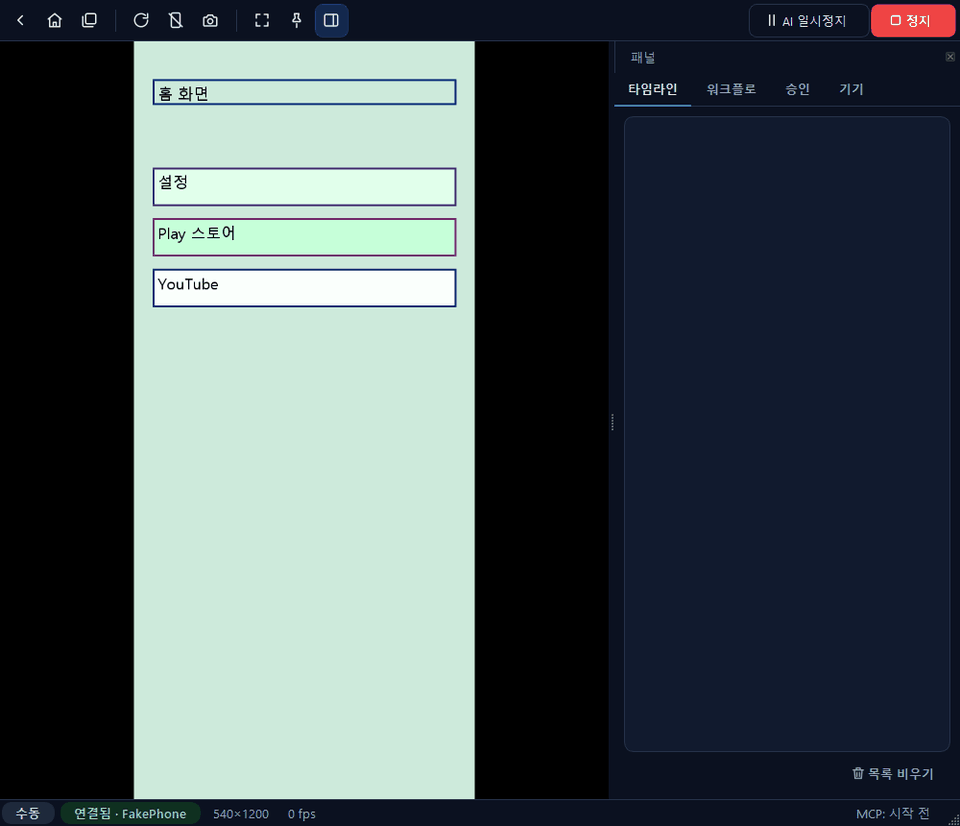
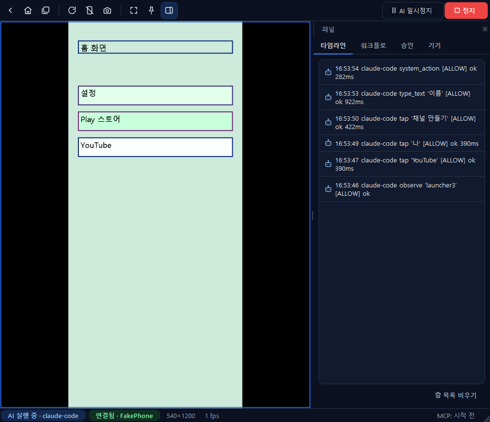
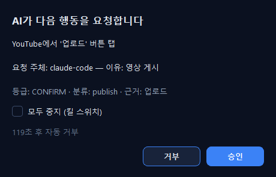
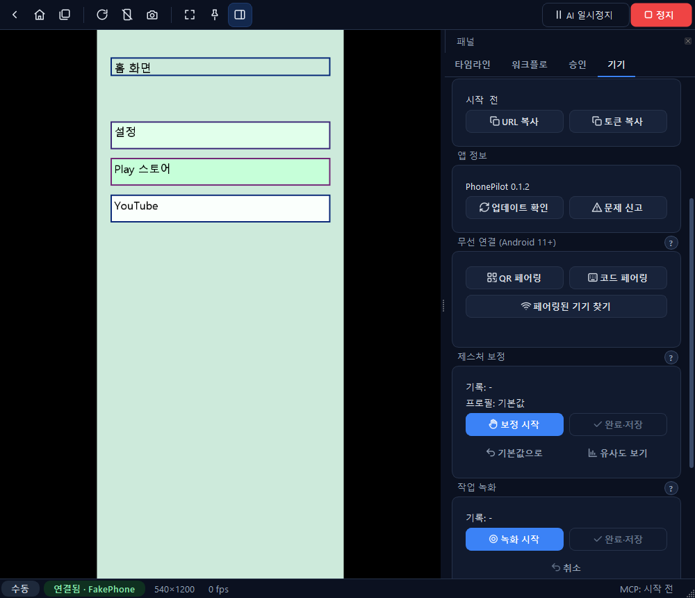

# PhonePilot

[](https://github.com/ghlee0786/phonepilot/actions/workflows/ci.yml)
[](https://github.com/ghlee0786/phonepilot/releases)

**내 Android 폰을 PC 화면에 띄워 마우스로 쓰고, AI에게도 맡길 수 있는 Windows 프로그램**



*AI(Claude)가 YouTube를 열고 → '나' → '채널 만들기' → 이름을 입력하는 장면. 오른쪽 타임라인에 AI가 한 일이 하나씩 기록됩니다. (폰 없이 데모 모드로 녹화)*

---

## 한눈에 보기

| | |
| --- | --- |
| 🖥️ **폰을 PC에서** | USB나 Wi-Fi로 연결하면 폰 화면이 PC 창에 그대로 뜹니다. 클릭은 터치, 휠은 스크롤, 키보드로 한글도 칩니다. 폰에 따로 설치할 앱은 없습니다. |
| 🤖 **AI가 대신 조작** | Claude 같은 AI가 화면을 읽고 버튼을 눌러 작업합니다. MCP라는 표준 방식으로 연결합니다. |
| ✋ **내 손버릇 그대로** | 내 터치를 몇 번 보여 주면 누르는 시간·스와이프 속도를 배워서, AI도 같은 방식으로 터치합니다. |
| 🎬 **한 번 보여 주면 반복** | 작업을 한 번 직접 하면서 녹화하면, 다음부터는 AI가 같은 순서로 반복합니다. |
| 🩺 **스스로 복구** | 화면이 멈추거나 연결이 끊기면 스스로 알아채고 다시 연결합니다. 문제가 있으면 상태 표시가 바로 경고로 바뀝니다. |
| 🔒 **안전이 먼저** | 비밀번호는 AI에게 보이지 않고, 결제·구독·보안 설정은 내가 [승인]해야 실행됩니다. `Pause` 키 하나로 AI를 바로 멈춥니다. |

## 이렇게 씁니다

1. **설치**: [Releases](https://github.com/ghlee0786/phonepilot/releases)에서 `PhonePilot-<버전>-setup.exe`를 받아 실행합니다(관리자 권한 불필요).
2. **폰 연결**: 폰에서 USB 디버깅을 켜고 케이블을 꽂습니다. PhonePilot 창에 폰 화면이 뜹니다.
3. **AI 연결**: Claude Code나 Claude Desktop에서 PhonePilot을 연결하고 "설정 앱 열어서 화면 밝기 보여줘"처럼 말로 시킵니다.

## 핵심 기능

### 1. 미러링과 직접 조작


- 화면 지연이 적습니다. 실제 폰(Galaxy S21+) 기준으로 연결 후 약 1초면 화면이 뜹니다.
- 왼쪽은 폰 화면, 오른쪽 **타임라인**에는 사람과 AI가 한 일이 시간순으로 쌓입니다.
- **파일 넣기**: PC의 파일·폴더를 폰 화면 위로 끌어다 놓으면 폰의 `/sdcard/Download`(기기 탭에서 변경 가능)로 복사됩니다. APK는 설치할지 묻습니다.
- 위쪽 버튼: 뒤로·홈·최근 앱, 회전, 스크린샷, 전체화면, **AI 일시정지**, **정지**.

### 2. 사람 승인


AI가 결제, 업로드, 좋아요·구독, 보안 설정처럼 되돌리기 어려운 일을 하려고 하면 이 창이 뜹니다.
내가 [승인]을 눌러야만 실행되고, 2분 동안 답이 없으면 자동으로 거부됩니다.

### 3. 내 손버릇 배우기 + 작업 녹화


- 각 영역 제목 옆의 **?** 를 누르면 사용법이 말풍선으로 뜹니다.
- **제스처 보정**: [보정 시작] → 폰 화면에서 평소처럼 탭·길게 누르기·스와이프 → [완료·저장]. 이후 AI의 터치가 내 속도와 습관을 따릅니다.
- **유사도 보기**: 내 터치와 AI 터치를 같은 기준으로 재서 항목별 점수(0~100)로 보여 줍니다.
- **작업 녹화**: [녹화 시작] → 작업을 한 번 직접 → [완료·저장]. 누른 버튼, 스와이프, 기다린 시간이 스킬로 저장되고, 워크플로 탭이나 AI 명령으로 다시 실행합니다. 입력한 글자는 저장하지 않고 실행할 때 다시 물어봅니다.

### 4. 연결 상태 감시와 자동 복구
- 2초마다 영상·조작 채널·디코더를, 15초마다 폰의 화면 서버와 포트 연결을 점검합니다.
- 화면이 멈추면 **키 프레임 요청 → 다시 연결 → adb 재시작** 순서로 스스로 복구하고, 그동안 상태 표시가 주황색 "⚠ 복구 중"으로 바뀝니다.
- 기기 탭 **연결 상태**에서 최근 장애와 복구 결과를 보고, [지금 점검]·[다시 연결]을 누를 수 있습니다. 기록에는 화면 내용이나 개인정보가 없습니다.

### 5. AI 연결 (MCP)
- 앱을 켜면 이 PC 안에서만 접속할 수 있는 MCP 서버가 열립니다(`127.0.0.1:47800`, 토큰 인증).
- AI는 도구 57개로 화면 읽기(`observe`), 누르기(`tap`), 입력(`type_text`), 스크롤, 앱 실행, 워크플로 실행을 합니다.
- 비밀번호는 `type_secret(ref="GOOGLE_MAIN_PASSWORD")`처럼 **이름으로만** 입력을 요청합니다. 값은 PhonePilot이 직접 칩니다.

> 상태: v0.1.7. 자동 테스트 327개 + 실기기 테스트 10개 통과. 실기기(Galaxy S21+ Android 15, Galaxy Note20 Android 13)에서 미러링, MCP 화면 읽기, 제스처 보정, 작업 녹화→재생을 확인했습니다.

---

## 목차

1. [자세한 기능](#자세한-기능)
2. [구조](#구조)
3. [요구 사항](#요구-사항)
4. [설치와 실행](#설치와-실행)
5. [폰 연결](#폰-연결)
6. [AI 연결](#ai-연결)
7. [MCP 도구](#mcp-도구)
8. [안전장치](#안전장치)
9. [대표 업무 워크플로](#대표-업무-워크플로)
10. [단축키](#단축키)
11. [설정 파일과 데이터 위치](#설정-파일과-데이터-위치)
12. [프로젝트 구조](#프로젝트-구조)
13. [테스트](#테스트)
14. [하지 않는 일](#하지-않는-일)
15. [현재 상태와 남은 일](#현재-상태와-남은-일)
16. [문서](#문서)

---

## 자세한 기능

### 미러링과 직접 조작
- **저지연 미러링**: scrcpy-server 4.1을 연결할 때마다 폰에 올려 실행합니다. 폰에 따로 설치하는 앱은 없습니다.
  H.264 영상을 그래픽카드(D3D11VA)로 디코드하고, 안 되면 CPU로 디코드합니다. 밀린 프레임은 버려 지연을 줄입니다.
  실기기 기준 첫 프레임까지 약 1초입니다.
- **USB와 무선 연결**: USB 디버깅, 그리고 Android 11 이상의 무선 디버깅(QR 페어링, 코드 페어링)을 지원합니다.
  한 번 페어링하면 같은 Wi-Fi에서 자동으로 다시 찾아 연결합니다.
- **PC에서 그대로 조작**: 클릭은 탭, 드래그는 스와이프, 휠은 스크롤, 우클릭은 뒤로, Ctrl+드래그는 핀치입니다. 키보드 입력과 한글 입력도 됩니다.
- **비율 유지 전체화면**: F11로 전체화면을 켜도 폰 화면 비율이 유지됩니다.

### AI 조작
- **MCP 서버 내장**: 앱이 `127.0.0.1:47800`에 MCP 서버를 띄웁니다. 토큰 인증이 필요하고, 같은 PC에서 오는 요청만 받습니다.
- **화면 이해**: 화면의 UI 구조를 읽어 누를 수 있는 요소에 번호를 붙이고, 번호를 그려 넣은 스크린샷(Set-of-Mark)을 함께 제공합니다.
  AI는 "3번 요소를 탭"처럼 정확하게 조작합니다.
- **사람다운 제스처**: 탭, 길게 누르기, 스와이프, 정밀 스크롤, 플링, 드래그, 핀치를 곡선 궤적으로 합성합니다.
  사용자가 직접 한 터치를 기록해 기기별 제스처 프로파일(누르는 시간, 스와이프 속도, 곡률, 멈췄다 떼는 시간)을 보정하고, 사람과 AI 제스처의 유사도를 측정합니다.
- **작업 녹화→스킬**: 사람의 시연을 셀렉터 기반 스킬 YAML(`recorded.<이름>`)로 저장하고, 제스처 프로파일로 재생합니다. 재생도 정책·승인 경로를 그대로 지납니다.
- **스킬과 워크플로**: 반복 작업을 YAML 스킬로 정의해 단계별로 실행합니다. 각 단계에 사후 조건 검사, 사람 개입, 승인, AI 복구를 넣을 수 있습니다.
- **내장 Claude 에이전트**: API 키를 넣으면 앱 안의 에이전트 패널에서 자연어로 작업을 시킬 수 있습니다. 비용과 단계 수에 예산이 걸려 있습니다.

### 보안과 통제
- 비밀값은 `.env` 한 곳에만 두고 AI에게는 이름만 공개
- 모든 출력(로그, 타임라인, 스크린샷, MCP 응답)에서 비밀값 자동 마스킹
- 비밀번호 입력란과 민감 앱(은행·증권·결제) 화면은 관찰 결과에서 가림
- 행동마다 정책 엔진이 위험도를 분류하고, 필요하면 PhonePilot 창에서 사람 승인
- 결제·주문·좋아요 일일 한도
- 세션이 끝나면 메모리의 비밀값, 폰 클립보드, 임시 파일을 정리(무흔적)

### 외부 서비스 연동 (선택, 기본 꺼짐)
- **YouTube Data API**: 채널 검색, 채널 통계, 카테고리 조회(읽기 전용)
- **Upbit, 한국투자증권(KIS)**: 시세, 잔고, 미체결 주문 조회. 주문은 초안을 만든 뒤 사람이 강화 승인해야 제출됩니다. KIS는 기본이 모의투자이고, 출금 기능은 없습니다.

---

## 구조

```
 Claude Code / Claude Desktop                PhonePilot 앱 (Windows)
 ┌───────────────────────┐   stdio   ┌──────────────────────┐  HTTP + 토큰  ┌──────────────────────────────────────────┐
 │ mcp__phonepilot__*    │──────────▶│ phonepilot-mcp.exe   │─────────────▶│ MCP 서버 127.0.0.1:47800                  │
 └───────────────────────┘           │ (중계기)              │              │   ToolService ── 모든 도구의 실제 구현     │
                                     └──────────────────────┘              │     관찰 → Observer (UI 트리 + 화면)       │
 내장 에이전트 · 워크플로 엔진 ───────── 같은 ToolService 직접 호출 ─────────▶│     행동 → 정책 엔진 → 승인 창             │
                                                                           │          → InputArbiter → scrcpy 제어     │
 사람 (마우스·키보드) ─── PhonePilot 창 ─────────────── InputArbiter ────────▶│   Redactor ── 모든 출력에서 비밀값 마스킹  │
                                                                           └────────────────┬─────────────────────────┘
                                                                                            │ adb (USB 또는 Wi-Fi)
                                                                                   Android 폰 (scrcpy-server 4.1)
```

- **하나의 행동 경로**: AI의 모든 행동은 `ToolService._act` → 정책 분류 → (필요 시) 승인 → `InputArbiter`를 지납니다. 우회 경로는 없습니다.
- **입력 중재**: 사람과 AI의 입력은 `InputArbiter` 한 곳으로 모입니다. 사람이 입력하면 진행 중인 AI 제스처가 취소되고 AI가 일시정지합니다.
- **스레드 구성**: Qt GUI 스레드, asyncio 코어 스레드(기기·도구·워크플로·MCP 서버), 영상 디코더 스레드로 나뉩니다.
- **중계기**: Claude Code는 stdio 중계기를 통해 붙습니다. 중계기는 앱이 시작할 때마다 새로 쓰는 토큰을 매번 다시 읽으므로, 앱을 다시 켜도 세션이 끊기지 않습니다.

---

## 요구 사항

| 항목 | 내용 |
| --- | --- |
| OS | Windows 10/11 |
| Python | 3.12 이상 (안정 버전. [uv](https://github.com/astral-sh/uv)로 관리 권장) |
| 폰 | Android 기기, 개발자 옵션의 USB 디버깅 허용. 무선 연결은 Android 11 이상 |
| 기기용 바이너리 | adb(platform-tools), scrcpy-server 4.1. `scripts/fetch_vendor.py`가 받아서 SHA-256을 검증합니다 |
| 주요 라이브러리 | PySide6, PyAV, adbutils, mcp 2.x, anthropic, uvicorn, pydantic, Pillow, numpy |

---

## 설치와 실행

### 설치 프로그램 (일반 사용자)
`PhonePilot-<버전>-setup.exe`를 실행합니다. 관리자 권한 없이 `%LOCALAPPDATA%\Programs\PhonePilot`에 설치됩니다.
설치 마법사는 기능 소개 4장 → 설치 위치 → 바로가기 → Claude Desktop 연결 → Anthropic API 키(선택) → 폰 준비 안내 순서입니다.
앱은 GitHub 릴리스로 업데이트를 확인합니다. 빌드·배포 방법은 [docs/RELEASE.md](docs/RELEASE.md)에 있습니다.

```powershell
# 명령줄 무인 설치(마법사 화면 없이)
PhonePilot-0.1.0-setup.exe /VERYSILENT /SUPPRESSMSGBOXES /NORESTART /TASKS="desktopicon"
```

### 소스에서 실행 (개발자)

```powershell
# 1) 가상환경 만들기 (안정 버전 Python 3.12)
python -m pip install uv
python -m uv venv .venv --python 3.12 --managed-python
python -m uv pip install --python .venv\Scripts\python.exe -e ".[dev]"

# 2) 기기용 바이너리 받기 (adb, scrcpy-server 4.1, SHA-256 검증)
.venv\Scripts\python.exe scripts\fetch_vendor.py

# 3) 사용자 설정 파일 만들기 (%APPDATA%\PhonePilot\.env 등) 후 .env 값 채우기
.venv\Scripts\python.exe -m phonepilot init

# 4) 점검
.venv\Scripts\python.exe -m phonepilot doctor

# 5) 실행
.venv\Scripts\python.exe -m phonepilot            # GUI + 첫 USB 기기 연결 + MCP 서버
.venv\Scripts\python.exe -m phonepilot gui --demo # 폰 없이 가짜 기기(FakeDevice)로 체험
```

### 명령 목록

| 명령 | 동작 |
| --- | --- |
| `phonepilot` 또는 `phonepilot gui` | GUI 실행, 첫 USB 기기 연결, MCP 서버 시작 |
| `phonepilot gui --demo` | 가짜 기기로 GUI 체험 (폰 불필요) |
| `phonepilot headless` | 화면 없이 기기 연결 + MCP 서버만 실행 (승인 창이 없으므로 승인이 필요한 행동은 모두 거부) |
| `phonepilot doctor` | vendor 바이너리, `.env`, 스킬, adb 상태 점검 |
| `phonepilot init` | 사용자 설정 폴더와 예시 파일 생성 |
| `phonepilot skill validate <파일>` | 스킬 YAML 검증 |
| `phonepilot-mcp` | Claude Code·Claude Desktop용 stdio 중계기 (설치본은 `phonepilot-cli.exe mcp-stdio`) |
| `phonepilot setup-claude` | Claude Desktop 설정에 중계기 등록(기존 설정과 병합, 백업) |

---

## 폰 연결

**USB**
1. 폰에서 개발자 옵션 → USB 디버깅을 켭니다.
2. 처음 연결할 때 뜨는 팝업에서 "이 컴퓨터에서 항상 허용"을 체크합니다.
3. 이후로는 케이블을 꽂고 PhonePilot을 실행하면 됩니다.

**무선 (Android 11 이상)**
1. PhonePilot의 기기 탭 → 무선 연결 → [QR로 페어링]을 누릅니다.
2. 폰에서 개발자 옵션 → 무선 디버깅 → "QR 코드로 기기 페어링"으로 스캔합니다.
3. 이후에는 같은 Wi-Fi에서 자동으로 찾아 연결합니다(포트가 바뀌어도 됩니다).
4. 재부팅이나 Wi-Fi 변경으로 무선 디버깅이 꺼지면 다시 켜고 [무선 기기 찾기]를 누릅니다.

공용 Wi-Fi에서는 쓰지 마세요. PhonePilot은 사설 IP 주소로만 무선 연결을 허용합니다.

---

## AI 연결

### Claude Code (권장)
저장소의 `.mcp.json`이 `phonepilot` 서버를 stdio 중계기(`.venv\Scripts\phonepilot-mcp.exe`)로 등록합니다. 다른 경로에 받았다면 `.mcp.json.example`을 참고해 경로를 고치세요.

1. PhonePilot 앱을 먼저 켭니다.
2. 이 폴더에서 Claude Code 세션을 엽니다. `CLAUDE.md`와 `.claude/skills/phonepilot-*` 스킬이 함께 로드됩니다.
3. 도구가 보이지 않으면 `/mcp`에서 `phonepilot`을 다시 연결합니다.

AI의 기본 작업 순서: `session_info` → `observe` → 행동 하나(`tap(element=N, obs_id=...)`) → 결과의 새 관찰 확인 → 반복.

**다른 폴더·새 세션에서 쓰기 (설치본)**: 사용자 범위로 한 번 등록하면 어느 폴더에서든 쓸 수 있습니다.

```powershell
claude mcp add phonepilot --scope user -- "$env:LOCALAPPDATA\Programs\PhonePilot\phonepilot-cli.exe" mcp-stdio
```

### Claude Desktop
설치 마법사에서 체크하거나 `phonepilot-cli.exe setup-claude`를 실행한 뒤 Claude Desktop을 재시작합니다. 직접 쓰려면 `claude_desktop_config.json`에 다음을 넣습니다.

```json
{ "mcpServers": { "phonepilot": { "command": "C:\Users\<사용자>\AppData\Local\Programs\PhonePilot\phonepilot-cli.exe", "args": ["mcp-stdio"] } } }
```

### 다른 AI 클라이언트
- **OpenAI Codex CLI, Cursor, VS Code 등 로컬 stdio MCP를 지원하는 클라이언트**: 같은 명령(`phonepilot-cli.exe mcp-stdio`)을 등록하면 됩니다. Codex는 `~/.codex/config.toml`에 `[mcp_servers.phonepilot]`로 `command`와 `args = ["mcp-stdio"]`를 넣습니다.
- **ChatGPT(웹·앱)**: OpenAI 서버에서 접속하는 원격 MCP만 지원하므로, 이 PC 안에서만 열리는 PhonePilot 서버에는 바로 붙지 않습니다. 폰을 조작하는 서버를 인터넷에 여는 것은 권하지 않습니다.

### HTTP 직접 연결
`http://127.0.0.1:47800/mcp`에 `Authorization: Bearer <토큰>` 헤더로 접속합니다. 토큰은 앱이 시작할 때마다 `%LOCALAPPDATA%\PhonePilot\mcp.token`에 새로 씁니다.

### 내장 에이전트
`%APPDATA%\PhonePilot\.env`에 `ANTHROPIC_API_KEY`를 넣으면 GUI 에이전트 패널과 워크플로의 `agent_step` 단계가 동작합니다. 기본 모델은 `claude-opus-5-5`입니다.

---

## MCP 도구

기본 도구 48개와 연동 도구 9개, 모두 57개입니다. 인자 전체는 [docs/MCP_TOOLS.md](docs/MCP_TOOLS.md)에 있습니다(코드에서 자동 생성).

| 분류 | 도구 |
| --- | --- |
| 관찰 (읽기 전용) | `observe`, `screenshot`, `zoom`, `ui_tree`, `find_elements`, `get_device_info`, `get_foreground_app`, `list_apps`, `get_gesture_profile` |
| 행동 | `tap`, `double_tap`, `long_press`, `swipe`, `scroll`, `scroll_to`, `fling`, `drag`, `pinch`, `type_text`, `press_key`, `system_action`, `launch_app`, `stop_app`, `open_url`, `push_file`, `install_apk`, `batch_actions` |
| 대기 | `wait_for`, `wait_stable`, `sleep` |
| 비밀값 (값은 반환되지 않음) | `list_secret_refs`, `type_secret`, `type_profile`, `secret_matches_screen` |
| 사람 개입·승인 | `request_human`, `request_approval`, `notify_user` |
| 스킬·워크플로 | `list_skills`, `get_skill`, `run_workflow`, `workflow_status`, `workflow_control`, `checkpoint`, `capture_backup_codes`, `verify_2sv_methods` |
| 세션 | `session_info`, `release_control`, `end_session_tool` |
| YouTube 연동 | `yt_search_channels`, `yt_channel_report`, `yt_category_list` |
| 거래소·증권 연동 | `market_quote`, `account_balances`, `account_open_orders`, `order_draft`, `order_submit`, `order_cancel` |

- **대상 지정**: 관찰 결과의 요소 번호(`element` + `obs_id`)를 권장합니다. 선택자(`selector`)나 정규화 좌표(`x_norm`/`y_norm`, 0~1000)도 쓸 수 있습니다.
- **스와이프**: `duration_ms`·`arc`를 비우면 제스처 프로파일을 따릅니다. `hold_end=true`면 끝에서 잠깐 멈춘 뒤 떼서 플링 없이 정확히 멈춥니다.
- **행동 결과**: 실행 후 화면이 안정될 때까지 자동으로 기다리고, `{ok, screen_changed, package_changed, new_dialogs, warnings}`를 돌려줍니다.
- **오류**: `{code, message, hint, retryable}` 형식으로 옵니다. 코드 목록은 [docs/MCP_GUIDE.md](docs/MCP_GUIDE.md) 10장에 있습니다.

---

## 안전장치

### 비밀값 격리
- 비밀값은 `%APPDATA%\PhonePilot\.env`에만 있습니다(저장소 밖, 본인만 읽기 권한).
- AI는 `list_secret_refs`로 키 이름과 종류만 받고, `type_secret(ref="GOOGLE_MAIN_PASSWORD")`처럼 이름으로 입력을 요청합니다.
- `type_secret`은 허용된 앱에서만, 비밀번호는 비밀번호 입력란에만 입력합니다.
- 비밀값을 `type_text`로 직접 치려고 하면 거부됩니다.
- 코드 안에서 비밀값은 출력·직렬화가 거부되는 전용 객체(`Secret`)에 담기고, 쓰고 나면 메모리를 0으로 덮어씁니다.

### 정책 엔진과 승인
모든 행동은 도구 종류, 현재 앱, 누르려는 대상의 글자, 화면 문맥을 보고 4단계로 분류됩니다. 신호가 엇갈리면 더 엄격한 쪽을 따릅니다.

| 단계 | 예 | 처리 |
| --- | --- | --- |
| ALLOW | 관찰, 일반 탭·스크롤, 앱 실행 | 바로 실행 |
| CONFIRM | 보내기·게시·업로드, 권한 허용, 좋아요·구독·댓글 | 승인 창 |
| CONFIRM_HIGH | 구매·결제·주문·송금, 2단계 인증 변경, 비밀번호 변경, 계정 삭제, APK 설치 | 강화 승인 창(금액 재확인) |
| BLOCK | 전화번호 2단계 인증 등록, 워크플로 안의 좋아요·구독 반복, CAPTCHA 조작, 한도 초과 | 실행 거부 |

- 승인은 **그 화면, 그 대상에만** 유효합니다. 승인한 뒤 화면이 바뀌면 무효가 되고 다시 요청해야 합니다.
- **승인 방식(수동/자동)**: 툴바의 [승인: 수동/자동] 버튼이나 `config.yaml`의 `safety.approval_mode`로 바꿉니다. 바꾼 값은 저장됩니다.
  자동 모드에서는 앱 권한 요청 창(카메라·저장소·알림 등)의 "허용"만 승인 창 없이 실행하고, 타임라인에 `auto_approved`로 남깁니다.
  결제·주문·보안 설정·좋아요/구독/댓글·APK 설치는 어느 모드에서든 승인 창을 띄웁니다.
- 120초 안에 응답이 없으면 시간 초과로 거부됩니다.
- 기본 한도: 인앱 결제 하루 0원(금지), 주문 1회 10만 원·하루 30만 원·하루 10건, 좋아요·구독 하루 5회.

### 사람에게 넘기기
폰 잠금 해제, CAPTCHA, 전화 인증, OTP 입력, 생체 인증은 AI가 하지 않습니다.
`request_human`으로 PhonePilot 창에 안내를 띄우고, 사용자가 직접 처리한 뒤 [완료]를 누를 때까지 기다립니다.

### 긴급 정지와 무흔적 종료
- `Pause` 또는 `Ctrl+Alt+End`를 누르면 PhonePilot 창이 앞에 없어도 AI가 즉시 멈춥니다. 눌려 있던 터치도 모두 해제됩니다.
- 세션이 끝나면 메모리의 비밀값을 지우고, 폰 클립보드를 비우고, 임시 파일과 서버 파일을 삭제합니다.
- 타임라인은 메모리에만 있고, 사용자가 내보낼 때만 파일로 저장됩니다.

---

## 대표 업무 워크플로

| 업무 | 내용 | 관련 파일 |
| --- | --- | --- |
| A. 구글 계정 + OTP 2단계 인증 | 사용자가 함께 있을 때 계정을 하나 만들고, 인증 앱(OTP) 방식만 등록합니다. 백업 코드 10개를 `Documents\PhonePilot-Recovery`에 저장하고(AI에게는 값이 가지 않음), 전화번호 방식이 0개인지 확인합니다 | `skills/google/account_with_totp.yaml`, `.claude/skills/phonepilot-google-2sv` |
| B. 유튜브 채널 생성 | 기획 인터뷰를 거쳐 채널 이름·핸들·설명·키워드·썸네일 스타일 후보를 만들고, YouTube 앱에서 채널을 생성합니다 | `skills/youtube/create_channel.yaml`, `.claude/skills/phonepilot-youtube-channel` |
| C. 채널 초기 운영 | 프로필 완성도 체크리스트, 유사 채널 읽기 전용 분석, 첫 4주 콘텐츠 계획 | `skills/youtube/channel_launch_checklist.yaml`, `.claude/skills/phonepilot-channel-launch` |
| D. 암호화폐·주식 조회 | 공식 API로 시세·잔고를 조회하고, 요청이 있으면 주문 초안을 만듭니다. 제출은 사람의 강화 승인이 필요합니다 | `.claude/skills/phonepilot-market-review` |

작업 녹화로 만든 스킬은 `%LOCALAPPDATA%\PhonePilot\recordings\`에 `recorded.<이름>`으로 저장되고, 사용자가 직접 만든 것이므로 저장과 함께 승인됩니다. 녹화에는 화면의 버튼 글자 같은 개인정보가 들어갈 수 있으므로 저장소에는 절대 넣지 않습니다(`.gitignore`로도 막혀 있습니다).

기본 제공 실행 스킬(`skills/`):
`android.dismiss_common_popups`, `android.go_home_clean`, `google.account_with_totp`, `google.open_security_page`, `youtube.create_channel`, `youtube.channel_launch_checklist`

스킬의 단계 종류는 `action`, `observe`, `assert`, `branch`, `loop`, `agent_step`, `human`, `approval`, `secret_input`, `call`, `capture` 11가지입니다.
사용자가 `%APPDATA%\PhonePilot\skills`에 넣은 스킬은 GUI에서 승인해야 로드됩니다. 비밀값을 템플릿에 넣는 스킬과 좋아요·구독을 반복하는 스킬은 로드가 거부됩니다.

---

## 단축키

수식키 Mod는 왼쪽 Alt입니다.

| 키 | 동작 |
| --- | --- |
| F11 / Esc | 전체화면 / 해제 |
| Mod+H / Mod+B / Mod+R | 홈 / 뒤로 / 최근 앱 |
| Mod+S | 스크린샷 |
| Mod+Space | AI 일시정지 / 재개 |
| **Pause** 또는 **Ctrl+Alt+End** | **AI 긴급 정지** (전역 단축키) |
| 우클릭 | 뒤로 |
| 마우스 휠 | 스크롤 |
| Ctrl+드래그 | 핀치 확대·축소 |

---

## 설정 파일과 데이터 위치

| 위치 | 내용 |
| --- | --- |
| `%APPDATA%\PhonePilot\.env` | 비밀값 (예시: `.env.example`) |
| `%APPDATA%\PhonePilot\secrets.meta.yaml` | 비밀값별 종류·허용 앱·허용 호스트 (예시: `secrets.meta.example.yaml`, 비밀 아님) |
| `%APPDATA%\PhonePilot\config.yaml` | 앱 설정, 안전 한도, 연동 켜기·끄기 (예시: `config.example.yaml`) |
| `%APPDATA%\PhonePilot\skills\` | 사용자 스킬 |
| `%LOCALAPPDATA%\PhonePilot\gesture_profiles.yaml` | 기기별 제스처 보정값(개인 측정값, 다른 PC로 동기화되지 않음) |
| `%LOCALAPPDATA%\PhonePilot\recordings\` | 작업 녹화 스킬(개인정보가 들어갈 수 있음, 저장소에 넣지 않음) |
| `%LOCALAPPDATA%\PhonePilot\` | MCP 토큰, 일일 카운터(날짜·합계만) |
| `%USERPROFILE%\Documents\PhonePilot-Recovery\` | 구글 백업 코드 보관함 |
| `%USERPROFILE%\Documents\PhonePilot-Assets\` | 폰으로 보낼 수 있는 파일 폴더(프로필·배너 이미지 등) |
| `policy/keywords.yaml`, `policy/sensitive_apps.yaml` | 정책 키워드와 민감 앱 목록 |

---

## 프로젝트 구조

```
src/phonepilot/
├── core/            기기 연결, 영상, 입력
│   ├── scrcpy/      scrcpy 프로토콜과 서버 실행
│   ├── adb.py       adb 서버·기기 목록·기기 정보
│   ├── wireless.py  무선 디버깅 페어링·재연결
│   ├── decoder.py   H.264 하드웨어 디코드
│   ├── framebus.py  최신 프레임 공유
│   ├── gesture.py   제스처 합성
│   ├── calibration.py 제스처 보정
│   ├── fidelity.py  사람·AI 제스처 유사도 측정
│   ├── arbiter.py   사람·AI 입력 중재
│   └── coords.py    좌표 변환
├── observe/         UI 트리 해석, 화면 해시·SoM 오버레이, 관찰 생성
├── security/        비밀값, 마스킹, 정책, 승인, 한도, 복구 코드 보관함, 세션 정리
├── agent/           ToolService, MCP 서버, stdio 중계기, 내장 에이전트, 타임라인
├── skills/          스킬 스키마·로더·워크플로 엔진, 작업 녹화(recorder.py)
├── integrations/    YouTube, Upbit, KIS, 주문 게이트
├── gui/             메인 창, 미러 화면, 패널, 대화상자, 전역 단축키
└── testing/         FakeDevice와 테스트 하네스
skills/              기본 실행 스킬(YAML)
.claude/skills/      Claude Code용 작업 절차 스킬
policy/              정책 키워드, 민감 앱 목록
installer/           Inno Setup 스크립트와 설치 마법사 이미지
packaging/           PyInstaller 설정
scripts/             vendor 받기, 도구 레퍼런스·README 이미지 생성, 릴리스 빌드·배포
tests/               단위·통합·GUI·실기기 테스트
docs/                PRD, 개발 문서, MCP 가이드, 도구 레퍼런스, 릴리스 안내, README 이미지
```

---

## 테스트

```powershell
.venv\Scripts\python.exe -m pytest                         # 단위·통합·GUI·시나리오 327개 (폰 불필요, 약 1분 30초)
.venv\Scripts\python.exe -m pytest -m device tests\device  # 실기기 테스트 (폰 연결 + 잠금 해제 상태)
```

- 폰이 없어도 `FakeDevice`(UI 트리 상태 기계 + 한글 폰트로 그린 가짜 화면)로 전체 흐름을 검증합니다.
- `tests/conftest.py`의 카나리 비밀값이 어떤 출력에도 나타나지 않는지 검사합니다.
- 테스트 이름과 코드 주석에 PRD 조항 번호(FR-xxx, SEC-xxx, TC-xxx)가 붙어 있어 요구사항에서 구현 위치를 바로 찾을 수 있습니다.

---

## 하지 않는 일

다음 기능은 "테스트용" 요청이라도 만들지 않습니다. 이유와 정당한 대안은 [docs/PRD.md](docs/PRD.md) 3.3장과 16장에 있습니다.

- 유사 채널 자동 스와이프·시청·좋아요·구독으로 계정 '에이징'
- 다수 계정 일괄 생성
- 봇 탐지 회피(무작위 지터 등)와 CAPTCHA 자동 풀이
- 전화번호 기반 2단계 인증 등록
- 금융 앱 보안 우회, 무인 자동매매, 출금

---

## 현재 상태와 남은 일

**완료**
- PRD 기준 기능 전체 구현: 미러링(USB·무선), 입력·제스처 합성과 보정, 관찰, 정책·승인·한도, 비밀값 격리, 복구 코드 보관함, 스킬·워크플로 엔진, MCP 서버, 내장 에이전트, 세션 정리
- 자동 테스트 327개 통과(GitHub Actions CI에서 매 push마다 실행), 실기기 테스트 10개 통과
- 실기기(Galaxy Note20, Android 13)에서 제스처 보정 측정값, 프로필 스크롤, 작업 녹화→재생 검증
- 설치 프로그램(Inno Setup), GitHub 릴리스 업데이트 확인, 문제 신고
- 작업 녹화→스킬과 재생, 사람·AI 제스처 유사도 측정
- 실기기(Galaxy S21+ SM-G996N, Android 15)에서 USB 미러링 확인: 864×1920, 하드웨어 디코드, 첫 프레임 약 1초
- MCP 중계기를 통해 실기기 `observe` 동작 확인

**남은 일**
- 실기기에서 기본 조작 시연(홈 → 설정 → 스크롤 → 뒤로)과 입력 지연 측정
- 무선 QR 페어링 실기기 검증
- YouTube·Upbit·KIS 연동의 실제 API 호출 검증(현재 단위 테스트만)

**알려진 제약**
- 일부 Samsung 기기(Android 15)에서는 scrcpy 서버 인자가 13개를 넘으면 서버가 죽습니다. 그래서 서버를 4.1로 고정하고 기본값이 아닌 인자만 넘깁니다. 자세한 내용은 [docs/DEVELOPMENT.md](docs/DEVELOPMENT.md) 4장에 있습니다.

---

## 문서

| 문서 | 내용 |
| --- | --- |
| [docs/PRD.md](docs/PRD.md) | 제품 요구사항 원본(27장 + 부록) |
| [docs/MCP_GUIDE.md](docs/MCP_GUIDE.md) | AI 조작 가이드: 연결, 관찰→행동 루프, 비밀값, 승인, 오류 코드, 업무별 절차 |
| [docs/MCP_TOOLS.md](docs/MCP_TOOLS.md) | MCP 도구 57개 인자 레퍼런스(자동 생성) |
| [docs/DEVELOPMENT.md](docs/DEVELOPMENT.md) | 코드 구조, 스레드 모델, scrcpy 프로토콜, 확장 방법, 문제 해결, 결정 기록 |
| [CLAUDE.md](CLAUDE.md) | Claude Code 세션용 요약과 절대 규칙 |
